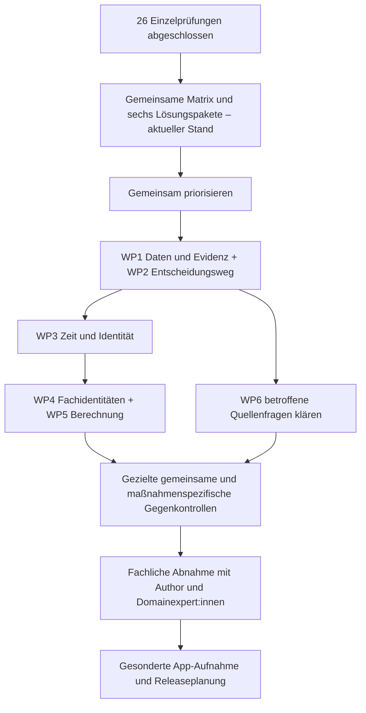

# Opus: gemeinsame Befunde nach allen 26 Einzelprüfungen

**Alle 26 historischen Runs sind nacheinander fachlich geprüft.** Die Sammlung ist vollständig; jede native App-Aufnahme bleibt wegen dokumentierter Befunde blockiert. Acht gemeinsame Problemfamilien und sechs konkrete Arbeitspakete stehen zur gemeinsamen Durchsicht bereit. Es wurde noch kein Regel- oder App-Umbau begonnen.

Sammlung weiterhin in [Issue #112](https://github.com/ghinta/oepul-rule-lab/issues/112), Branch `codex/opus-o6-1a-source-audit` und [PR #111](https://github.com/ghinta/oepul-rule-lab/pull/111). Unveränderter Kandidat `e009eed4a83ff076b26eba33ac433ac2b0642621`; alle abgeschlossenen Dossiers sind am Sammelstand `94a87276127ad76742b3cf93de84427d07f8529b` gebunden. Die maschinenlesbare [Matrix](cross-run-matrix.json) und ihre [Quellenbindungen](cross-run-matrix-provenance.json) enthalten die genauen Run-IDs, Beobachtungen und Dateien.

## Was wir gemeinsam lösen sollten

Zuerst sollten **App-Daten und Nachweise (WP1)** sowie **Status und Entscheidungsweg (WP2)** vereinheitlicht werden. Fehlende Angaben, ein positiver Helfer und eine theoretische Prämie dürfen nicht als abgeschlossene positive Prüfung erscheinen. Darauf bauen gemeinsame Zeit-/Identitätsbausteine, Fachklassifikationen und Betragsrechnung auf. Die vielfach bereits korrekten Tabellen und funktionierenden Gates werden erhalten.

[Die sechs Arbeitspakete](work-packages.md) nennen Ergebnis, Abhängigkeiten und überprüfbare Abschlusskriterien. Sie sind Vorschläge zur anschließenden gemeinsamen Priorisierung, keine bereits genehmigte oder ausgeführte Implementierung. Für den Prüfabschluss fehlt kein Input von GM. Die vorhandene Konvention „Freigabe nur mit positivem erforderlichem Nachweis“ steht fest und wird nicht erneut je Maßnahme abgefragt.

Dieser Ablauf betrifft die Aufnahme der historischen Opus-Policies. Bestehende produktive Regeladaptationen, der bisherige App-Release und der vom Nutzer selbst übernommene manuelle SQL-Export/-Import bleiben eigene Vorhaben. Aus dieser Sammlung wird keine Aussage abgeleitet, sämtliche bestehenden App-Funktionen seien unbrauchbar oder ein bestehender Serverrelease pauschal unmöglich.

## Gemeinsame Problemfamilien

### F1 – App-Daten erreichen den nativen Regelpfad nicht

Jeder der 26 Dossiers dokumentiert eine tatsächlich ausgeführte App-Projektion am selben Commit mit SQL-Guard. Ergänzungen gehen verloren; einzelne bestehende Pfade bleiben. Der Unterschied zu produktiven separaten Regeladaptationen bleibt erhalten.

**Gemeinsamer Ansatz:** Versionierter Eingabevertrag mit nachvollziehbarer Abbildung bis zum tatsächlichen OPA-Payload; manuell belegbare noch fehlende Felder sichtbar machen.

**Erhaltene Unterschiede:** o6_20: ein bestehender Vorschlagspfad erhalten, 92 neue fehlen. Feste Root-/Blattzahlen werden nicht verwechselt.

Beispiele: [Dossier 1](../opus-o6-1a-audit-20261015/README.md); [Dossier 2](measures/o6_1b/README.md); [Dossier 3](measures/o6_1c/README.md); [Dossier 4](measures/o6_2/README.md).

### F2 – Positiver Nachweis, null und fehlend

Günstige Defaults und Rego-Typordnung können unbekannte Voraussetzungen positiv behandeln; zulässiges null kann MAIN oder nur Helfer abbrechen.

**Gemeinsamer Ansatz:** Aktiv anwendbare Pflichtdaten vor Verwendung typisieren und auf Nachweis prüfen. Fehlender erforderlicher Nachweis setzt Tool-Freigabe false; der Rohwert bleibt unbekannt. Bekannte Nichtanwendbarkeit und echte numerische Null (0) getrennt.

**Erhaltene Unterschiede:** 5/13 und 1C haben in ihren gezielten gültigen Nullable-Kontrollen keinen entsprechenden Absturz; 15 leitet Kategorie-null richtig ab. Keine pauschale Gleichsetzung von null und false oder jeder Nullmenge mit Ablehnung.

Beispiele: [o6_1a / `required-contract_start_year-null`](../opus-o6-1a-audit-20261015/observations.json); [o6_1a / `rgve-average-none`](../opus-o6-1a-audit-20261015/observations.json); [o6_14 / `O614-IN-optional-category-null-known-species-age-breed`](measures/o6_14/observations.json); [o6_22 / `O622-IN-ACTIVE-TGD-participation_from-NULL`](measures/o6_22/observations.json); [o6_24 / `O624-IN-NULLABLE-24-NULL`](measures/o6_24/observations.json).

### F3 – Vertrag, Diagnose und Geld haben verschiedene Reichweiten

Helfer erkennen Ausstieg, Ausschluss oder fehlenden Claim; der Betrag oder ein Status nutzt diese Zustände nicht durchgehend. Andere Runs verbinden mehrere Sperren bereits korrekt.

**Gemeinsamer Ansatz:** Gemeinsamer vollständiger Ausgabevertrag: Vertrag, Zugang, Schlageignung, Pflichtbefund, tatsächliche Behördenstufe und zulässige Betragskomponenten explizit zusammenführen; normale Neuanmeldung und tatsächlich genehmigte Übernahme getrennte Routen.

**Erhaltene Unterschiede:** 12 nennt den Wert ausdrücklich Schätzung; 14 vor Inhaltskürzung. Ein frischer lokaler Verstoß hat ohne Behördenbewertung keinen erfundenen 100%-Satz. Falscher Status bei korrekter Nullzahlung ist kein positiver Geldfehler.

Beispiele: [o6_17 / `O617-GEN-ACTUAL-FINAL-EXCLUSION`](measures/o6_17/observations.json); [o6_23 / `O623-GEN-ACTUAL-TAKEOVER-2026-04-15-0`](measures/o6_23/observations.json); [o6_24 / `O624-GEN-ACTUAL-APPROVED-TAKEOVER-2026-04-15`](measures/o6_24/observations.json); [o6_24 / `O624-GEN-MIN-AREA-1.99`](measures/o6_24/observations.json).

### F4 – Jahr, Intervalle und Fristklassen

Alte oder überjährige Ereignisse, crop-/contract ownership, unvollständige Historien und bloße Tagesdifferenzen erzeugen wiederkehrende Abweichungen.

**Gemeinsamer Ansatz:** Gemeinsame Ereignis-/Intervallbausteine mit maßnahmenspezifischem Beginn, Ende und Zählregel; Fristen nach Norm und Ausnahmefamilie parametrisieren, Kalender/Geltungsfassung binden.

**Erhaltene Unterschiede:** 4 filtert Mahd-/Dünger-/PSM-Jahre korrekt. Manche Run-Verträge verlangen bereits vorgefilterte Jahreswerte; historische Ereignislisten werden dort nicht nachträglich als versprochene Schnittstelle unterstellt. Dezember- und Monitoringfristen sind ausdrückliche §5-Ausnahmen.

Beispiele: [o6_4 / `o6_4-grazing-cross-year-interval`](measures/o6_4/observations.json); [o6_6 / `O66-CORE-known-prior-year-sowing`](measures/o6_6/observations.json); [o6_22 / `O622-GEN-TIERLISTE-WORKDAY-2023-04-17`](measures/o6_22/observations.json); [o6_24 / `O624-GEN-FM-WORKDAY-2026-06-29`](measures/o6_24/observations.json).

### F5 – Identität, Mengenbasis, Geografie und Einheiten

Doppelte physische Einheiten, Konflikte bei gleicher ID, Count+Einzeltiere sowie ungefilterte Auslands-/Almfläche können andere Zahlbeträge oder Runtime ergeben.

**Gemeinsamer Ansatz:** Stabile Einheit plus Zeitbezug und Datenherkunft; echte Dublette, Konflikt und erlaubte zweite Episode unterscheiden. Ausschlüsse in allen Nennern/Komponenten anwenden; explizite ermittelte Mengen an tatsächliche qualifizierte Einheiten binden.

**Erhaltene Unterschiede:** 23 gleicht Objekte als Set ab, 24 als ID→Ganzobjekt; die Fehler sind verschieden. Technisch widersprüchliche Mengen sind keine konsistenten realen AMA-Bescheide. Heim-/Alm-Trennung gilt anders für 14/15 als für Heimgutmaßnahmen.

Beispiele: [o6_1a / `foreign-in-denominator`](../opus-o6-1a-audit-20261015/observations.json); [o6_14 / `O614-GEN-global-modulation-amount`](measures/o6_14/observations.json); [o6_23 / `O623-IN-DUPLICATE-PARCEL-WITH-UNUSED-METADATA`](measures/o6_23/observations.json); [o6_24 / `O624-IN-AGGREGATE-BYPASS-OPWRRL`](measures/o6_24/observations.json); [o6_24 / `O624-IN-CONFLICT-SAME-ID-soil_type`](measures/o6_24/observations.json).

### F6 – Fachidentitäten und Tabellenverbraucher

Tabellen sind vielfach vollständig und richtig, werden aber nicht vollständig verbraucht oder mit freiem Namen statt fachlicher Identität verbunden.

**Gemeinsamer Ansatz:** Belegte IDs/Aliasse, Kultur-Sorte- und Tierart-Kategorie-Verknüpfung; Tabellenfamilien nach Quelle/Version gemeinsam prüfen. Offene Beispielgruppen von echten geschlossenen Listen unterscheiden.

**Erhaltene Unterschiede:** Ein unbekannter Freitext wird nicht allein durch Namensähnlichkeit als zugelassen klassifiziert. Vollständige Preise, Listen und Matrixzellen belegen noch keine vollständige Pflichtausführung.

Beispiele: [o6_1a / `slk-weizen`](../opus-o6-1a-audit-20261015/observations.json); [o6_16 / `O616-DOM-PSM-BAN-Körnermais`](measures/o6_16/observations.json); [o6_18 / `O618-DOM-FERT-TYPE-ND01-festmist`](measures/o6_18/observations.json); [o6_24 / `O624-DOM-NMIN-REAL-UNTABULATED-PAPRIKA`](measures/o6_24/observations.json); [o6_24 / `O624-IN-ACTUAL-WECHSELWIESE-PERIOD`](measures/o6_24/observations.json).

### F7 – Reihenfolge, Verteilung und vier verschiedene Numerikfragen

Modulationsbasis, Mengenverteilung und Cap-Verbrauch wiederholen sich. Daneben gibt es lokale Vorabrundung, internen Rechenrest, Zahlenschreibweise im Schlüssel und den gesonderten Vergleichsbefund der konkreten Binary.

**Gemeinsamer Ansatz:** Gemeinsame Komponentenrechnung mit expliziter Zuteilung und Quellenreihenfolge; Geld/Fläche/N-Einheit/Rundungsstufe festlegen. Tatsächliche App-Binary separat binden und unabhängige exakte Grenzfälle verwenden.

**Erhaltene Unterschiede:** Keine stillschweigende neue OPA-Version, Float-Toleranz oder universelle Cap-Zuteilung. Eigener falscher 100/103-Sollfall aus 24 ist ausgeschlossen; 10/10,3 ist davon unabhängig.

Beispiele: [o6_7 / `o6_7-coverage-two-decimal-ha-rounding`](measures/o6_7/observations.json); [o6_9 / `o6_9-method-bound-invalid-biogas-amount`](measures/o6_9/observations.json); [o6_23 / `O623-DOM-ORDER-SANCTION-BEFORE-CAP`](measures/o6_23/observations.json); [o6_24 / `O624-GEN-DETERMINED-AREA-10-10.3`](measures/o6_24/observations.json).

### F8 – Quellenstand und tatsächliche Genehmigung

Pakete liefern unterschiedliche Originale. Angaben aus Merkblatt, SRL, GSP und Hinweisen können kollidieren; Antrag, Genehmigung und deren Fläche/Zeit/Pflichtumfang sind nicht gleich.

**Gemeinsamer Ansatz:** Gemeinsames Quellen- und Geltungsregister sowie datierte anwendungsbezogene Genehmigungsobjekte; offene Kollisionen pro Quellenpaar vor späterer Promotion klären.

**Erhaltene Unterschiede:** GSP/NAPV anderer Pakete werden dem historischen Run nicht als geliefert zugerechnet. Ein rechtzeitiges Ansuchen ist keine anerkannte Ausnahme. Die bereits vereinbarte Fehlend-Regel wird nicht erneut zur Entscheidung gestellt.

Beispiele: [o6_24 / `O624-IN-PRE-JUN8-VERSION-NOTICE`](measures/o6_24/observations.json).

## Alle 26 Runs mit ihren Unterschieden

Die Zuordnung bezeichnet sinnvolle gemeinsame Lösungsbereiche. Sie zählt keine unabhängigen Defekte und behauptet nicht, jeder Run habe jeden Fehler einer Familie. „Fälle“ bezeichnet nur den veröffentlichten Hauptsatz je Dossier; UBB enthält zusätzliche überlappende Teilkontrollen, die hier nicht addiert werden.

| Run / Dossier | Katalogregeln | Fälle | Arbeitspakete | Konkrete Befunde und erhaltene Unterschiede |
|---|---:|---:|---|---|
| [o6_1a – UBB](../opus-o6-1a-audit-20261015/README.md) | 166 | 43 | WP1, WP2, WP3, WP4, WP5 | Vertrags-/Claimhelfer, Kultur-Sorte, Auslandsnenner, DIV-/WB-Nutzungsfenster; RGVE-null. Listen sind vorhanden; 43 Hauptfälle plus gesonderte überlappende Unterchecks, keine Addition zur unabhängigen Stichprobe. |
| [o6_1b – BIO](measures/o6_1b/README.md) | 200 | 107 | WP1, WP2, WP3, WP4 | Konventioneller Teilbetrieb, Kombinationen und DIV-Flächendoppelzählung; Kultur-Sorte und Nullwerte. Aktive Normalisierungstabellen vorhanden; UBB-Reinigungsschnittbefund gilt hier nicht pauschal. |
| [o6_1c – Nichtproduktive Ackerflächen / Agroforst](measures/o6_1c/README.md) | 97 | 109 | WP1, WP2, WP3, WP6 | Jahresschnitte, AFS-Nachweis, Vertragsjahre, Ausschlusszählung und aktuelle GLÖZ-8-Fassung. Prämienbänder und Vier-Prozent-Deckel funktionieren; beobachtete Abstürze sind außerhalb der Form. |
| [o6_2 – Einschränkung Betriebsmittel](measures/o6_2/README.md) | 82 | 157 | WP1, WP2, WP3, WP4 | Ganzjährige Weitergabe, Jahresmahd, Kombinationsunterbedingungen; MAIN ohne Futterfläche undefiniert. Fremde Tiere/Flächen und Zweitkultur werden teils richtig getrennt; einzelne Kürzungsfolge korrekt. |
| [o6_3 – Heuwirtschaft](measures/o6_3/README.md) | 74 | 158 | WP1, WP2, WP3, WP5 | Vorjahresmahd wird aktuell; VF/DIV-Ausschlüsse, zu breites FM-Flag, Cap-Hinweis vor Modulation. Eigenes average_count unterstützt Bruchteile; bei gültigen aktuellen Schnitten stimmt das 1.603,80-€-Beispiel. |
| [o6_4 – Bergmähder](measures/o6_4/README.md) | 90 | 185 | WP1, WP2, WP3, WP5 | Überjähriges Weideintervall, amtliche Flächen-/Sanktionsbasis, LSE-Feldstückgrenze, Fristen. Mahd-/Dünger-/PSM-Jahresfilter und Teilkürzungsfolge korrekt; derselbe Vorjahresmahdfehler liegt hier nicht vor. |
| [o6_5 – Gefährdete Nutztierrassen](measures/o6_5/README.md) | 97 | 233 | WP1, WP2, WP3, WP4 | Ersatzalter, Folgejahreszulassung, Begrenzung der Nachbesetzungskette und alte Aufenthaltsbefunde. Förderplatz/Ersatz vermeidet zweite Prämie; Rasse/Art/Kategorie und positive Nachweise sind verbunden; kein beobachteter gültiger Nullabbruch. |
| [o6_6 – Zwischenfruchtanbau](measures/o6_6/README.md) | 111 | 391 | WP1, WP2, WP3, WP4 | Alte Saat als aktueller Bestand, 6/7-Konflikt, Frost-/Methodenbedingungen, Phasenende und Nullwerte. Veröffentlichte V1-Datumsbeispiele stimmen; Prämienband ist kein amtlicher Auszahlungssatz. |
| [o6_7 – System Immergrün](measures/o6_7/README.md) | 107 | 318 | WP1, WP2, WP3, WP5 | Jahresendlücke, gerundete 15%-Schwelle, zu breite Dürreausnahme und Methodenqualifikation. Aktuelle Teilnahmeliste gefiltert; lokaler Lückenbefund unter 15% ist kein automatischer betrieblicher Verstoß. |
| [o6_8 – Erosionsschutz Acker](measures/o6_8/README.md) | 114 | 313 | WP1, WP2, WP3, WP5 | Wirksamer Ausstieg/Claim nur Helfer, Winterackerbohnenfrist, Cap-Basis und nicht datierte BAW-Phase. MS+US wird im ausgegebenen Hauptsummenpfad einmal gezählt; Vertragshorizont und Dürre-Saisonprüfung sind vorhanden. |
| [o6_9 – Bodennahe Ausbringung / Separation](measures/o6_9/README.md) | 89 | 335 | WP1, WP2, WP3, WP4, WP5 | Verfahrensverteilung trotz richtiger Gesamtmenge, Auslands-GVE, NAPV-Warnreichweite und Fristen. Rationswerte, GVE/Tarife und positive Komponenten stimmen; proportionale Überkappungsverteilung bleibt Annahme. |
| [o6_10 – Erosionsschutz Wein / Obst / Hopfen](measures/o6_10/README.md) | 91 | 373 | WP1, WP2, WP3, WP4 | Nicht erkannte Zerstörungs-/Neupflanzereignisse, Vorprogramm-Antrag und offene Obstnamen. Vertrags-/Claim-/Kontroll-/AMA-Geldgates integriert; überjährige Rodungsfrist bleibt konkret falsch. |
| [o6_11 – Herbizidverzicht](measures/o6_11/README.md) | 76 | 413 | WP1, WP2, WP3, WP4 | Obstidentität, Ausland im Verzicht/Minimum, gemischte PSM-Codierung und zu weiter BIO-Zielvermerk. Keine BIO-Herbizidausnahme; tatsächliche Geldgates funktionieren, Vertragslabel kann bei korrekter Nullzahlung falsch bleiben. |
| [o6_12 – Insektizidverzicht](measures/o6_12/README.md) | 94 | 508 | WP1, WP2, WP3, WP4, WP6 | Unbearbeiteter Ausstiegsantrag als Ausnahme, aktueller Vertragsverlauf, PSM-Quellenkonflikt und Obstidentität. Ausgabe ausdrücklich Schätzung; Bio-Insektizid/behördliche Anordnung haben eigene Voraussetzungen, keine Übertragung aus 11. |
| [o6_13 – Nützlinge im geschützten Anbau](measures/o6_13/README.md) | 80 | 430 | WP1, WP2, WP3, WP4 | Auslands-/Verkaufsfläche im Mindestgrößenfallback, Parkname und Antrag vor Programmöffnung. Register-/Aufwand-/Ersatznachweise werden positiv verlangt; reiner Verkaufsstruktur-Helfer falsch, MAIN korrekt null; kein beobachteter gültiger Nullabbruch. |
| [o6_14 – Almbewirtschaftung](measures/o6_14/README.md) | 126 | 618 | WP1, WP2, WP3, WP5, WP6 | Globales Modulationsminimum statt Summe lokaler Minima; nullige RGVE-Kategorie verhindert Ableitung. Ausgelassene Kategorie funktioniert; enum(1|2|3) bleibt Primitivmehrdeutigkeit, kein still behaupteter String-Schemafehler. |
| [o6_15 – Tierwohl Behirtung](measures/o6_15/README.md) | 95 | 601 | WP1, WP2, WP3, WP5 | Auslands-Modulation, Ausschluss/aktueller Claim nicht am Betrag und bedingte Hunde-/Personen-/Intervallscopes. Kategorie-null wird richtig abgeleitet; Quellen enthalten zwei tatsächliche Rechenfehler, die dem Modell nicht angelastet werden. |
| [o6_16 – Grundwasserschutz Acker](measures/o6_16/README.md) | 98 | 358 | WP1, WP2, WP3, WP4, WP5, WP6 | Ausstieg/Ausschluss/Geld, AG-Parkfläche, Maisidentität und Schlüssel 14 gegenüber 14.0. 1.566 KG-Zeilen, 420 Kombinationszellen und 270 NAPV-Felder stimmen; zukünftiger Probenbedarf wurde nicht erfunden. |
| [o6_17 – Humuserhalt Grünland](measures/o6_17/README.md) | 133 | 326 | WP1, WP2, WP3, WP5 | Tatsächliche Kürzungen/Exit/Übererklärung nur Helfer; Fristen, interner strikter 3%-Vergleich, Jahresbezug. Proben-ID-Deduplikation, 50 Kennartgruppen und Modulation vor Cap funktionieren. |
| [o6_18 – Naturschutz](measures/o6_18/README.md) | 125 | 529 | WP1, WP2, WP3, WP4, WP6 | Nicht konsumierte ND-/NE-Pflichten, GVE-Zeitbasis, Nutzungsarten und Dürrefreigabe für Weide. 333 Tarifzeilen/332 Hauptcodes stimmen; eigener ungültiger AA01-Vergleich ist ausdrücklich kein Opus-Befund. |
| [o6_19 – Ergebnisorientierte Bewirtschaftung](measures/o6_19/README.md) | 102 | 372 | WP1, WP2, WP3, WP5, WP6 | Positive Geldkomponenten trotz negativer Diagnose, Rückforderungsbefreiung, Heim-/Alm-Basis und Outputtotalität. AMA-Stufen und endgültiger Ausschluss bereits verbunden; alle 204 Originalpreisfelder stimmen. |
| [o6_20 – Tierwohl Weide](measures/o6_20/README.md) | 97 | 262 | WP1, WP2, WP3, WP5, WP6 | no_premium nicht am Geld, Heim-/Alm-Basis, Dürre-Tagesdiagnose und Doppelrepräsentation von Tieren. Aktuelle Sperrgates und Tabellen funktionieren; ein bestehendes Vorschlagsblatt bleibt in der App, 92 neue fehlen. |
| [o6_21 – Stallhaltung Rinder](measures/o6_21/README.md) | 95 | 326 | WP1, WP2, WP3, WP5, WP6 | Bekannte Mindestfläche wird bei unbekanntem Gewicht übersprungen; Meldefristen, sieben aktive Nullblätter, Zeit-/Identitätsscopes. Geld/RGVE dedupliziert identische Tiere, Bruttoaggregate nicht; Gewichtsschnitt 500 kg bleibt Quellüberlappung. |
| [o6_22 – Schweinehaltung](measures/o6_22/README.md) | 125 | 350 | WP1, WP2, WP3, WP5, WP6 | Kohorten-/Zuschlagsdiagnose ohne Mengenwirkung, ausgeschlossene Fremdgruppe, nulliger TGD-Beginn und doppelte Gruppen. Mengenabzug und Zugangs-/Abmeldegates funktionieren; vier gültige Nullblätter, 85-kg-Grenze und Kompostscope gesondert. |
| [o6_23 – Natura 2000](measures/o6_23/README.md) | 88 | 300 | WP1, WP2, WP3, WP5, WP6 | Genehmigte Übernahme ohne MAIN-Route, Cap-Reihenfolge, Metadatenkopie verdoppelt Schlagbetrag und ein gültiger Nullabbruch. Gewöhnliche unbekannte Einstiegsdaten und Kampagne 2029 sperren; K20-Zeitzeile ist ungenutzte allgemeine Metadatenabweichung ohne N2-Geldwirkung. |
| [o6_24 – Wasserrahmenrichtlinie](measures/o6_24/README.md) | 95 | 537 | WP1, WP2, WP3, WP4, WP5, WP6 | Übernahme, falsches Lapse-Label, Paprika-Nmin, Wechselwiesenzeitraum, sieben Nullblätter und ungebundene Mengenaggregate. Alle 408 Tabellenvergleiche stimmen; zwei eigene falsche >2-ha-Sollvergleiche und zeitlich gemischte 2023-Vorlage bleiben gesondert. |

## Grenzen und Qualität der Zusammenführung

Alle 26 Übersichtsdossiers wurden für diese Zusammenführung erneut gelesen; die genannten Fälle und ihre nativen Beobachtungen wurden gezielt abgeglichen. Die ursprünglichen vollständigen Quellenlesungen bleiben in den Einzeldossiers dokumentiert. 285 unveränderte Evidenzdateien sind für die Matrix mit Bytes und SHA gebunden; alle 358 bereits vorhandenen Qualitätsbindungen wurden geprüft. Unterschiedliche frühere Manifestformen (UBB 13, BIO 9, andere 14 Dateien) bleiben sichtbar. Es wird kein nachträglicher einheitlicher Vierzehn-Dateien-Abschluss aller frühen Dossiers erfunden.

Einige früh formulierte Teilbefunde enthalten noch einen Entwurfsstatus wie „pending common execution“. Der tatsächliche Abschluss ergibt sich aus Queue, Gesamtsammlung, Beobachtungen und Qualitätsbericht. Diese alten Strings werden weder als offene Einzelprüfung missverstanden noch still in eingefrorenen Teilen umgeschrieben.

Die Fälle sind öffentlich, gezielt und teils verwandt. Hypothetische bekannte Tatsachen, gewünschte positive Nachweise, bedingte Input-/Behördenverträge, Strukturstress und eigene Konstruktionsfehler bleiben getrennt. Insbesondere der eigene AA01-Fall aus 18, der falsche >2-ha-Sollfall aus 24 und dessen zeitlich gemischte 2023-Vorlage sind keine unabhängigen bestätigten Opus-Fehler. Keine Gesamtgenauigkeit, Modellrangliste oder private Testpartition wird aus Fall-/Check-/Befundsummen berechnet.

Frühere Dossiers enthalten getrennte Agenten-Unterchecks. Die fortgesetzten Abschlüsse ab 16 wurden von Root selbst gegengeprüft; eine weitere unabhängige Person wird nicht behauptet. Keine GM-/Domainexpertenfreigabe folgt aus diesem Audit. Quellenzitate, Hashes, Kompilierung und reproduzierbare auch fehlerhafte Ausgaben ersetzen diese fachliche Abnahme nicht.

Die Quellenpakete unterscheiden sich. GSP/NAPV aus einem anderen Run gelten nicht rückwirkend als gelieferte Modelleeingabe. Aktuelle Quellenhierarchie und spätere fachliche Verwendbarkeit bleiben eigene Prüffragen. Der [Einheitenkorrekturbeleg](unit-label-erratum-20261016.md), die [gesonderte Binary-Numerikprüfung](runtime-numeric.md) und alle eigenen Korrekturreceipts bleiben verlinkt.

Die tatsächlichen App-Projektionen beziehen sich auf Commit `529eadb34c4fdd249fbf739a372d63185b7374a2` mit gesperrtem SQL und null Datenbankaufrufen. Sie beweisen die dort dokumentierte Roh-Run-Schnittstellenlücke. Historische Regeln, Daten, Quellen, Canonical, App und OPA-Pin wurden in dieser Sammlung nicht verändert. Auto-Merge bleibt aus; der aktuelle technische CI-Stand steht im PR.
